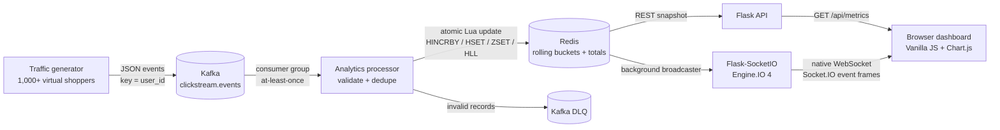
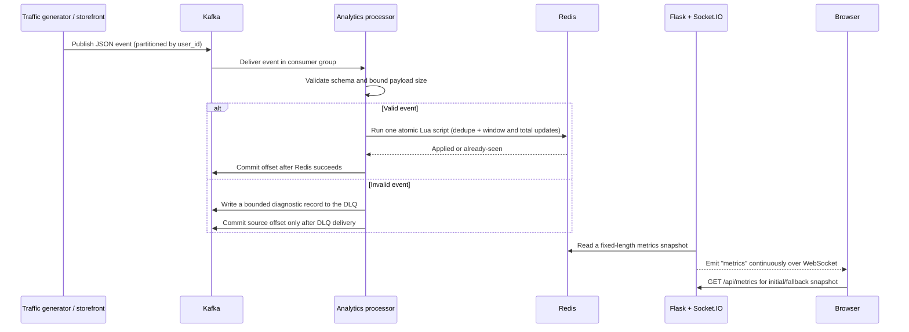

# Distributed Real-Time Analytics Engine

A runnable e-commerce clickstream pipeline built with Flask, Flask-SocketIO, Apache Kafka, Redis, and a no-build vanilla JavaScript dashboard. Events are accepted asynchronously by Kafka, validated and aggregated by a consumer, stored as atomic Redis counters/windows, then served over REST and pushed to the browser in real time.

## Architecture



### Event processing flow



The browser uses the **native `WebSocket` API** and contains a small client for the Engine.IO 4 / Socket.IO default-namespace handshake and event frames. Flask-SocketIO speaks the Socket.IO protocol (not a bare WebSocket protocol), so this adapter lets the frontend stay vanilla without adding `socket.io-client`.

## Features

- **Kafka ingestion:** one topic partitioned by `user_id`, idempotent producer settings, explicit consumer offsets, and automatic creation of the main and dead-letter topics.
- **1,000+ concurrent synthetic users:** a shared thread-safe Kafka producer is driven by configurable Python worker threads; each virtual user has a stable synthetic identity and session.
- **Validated event contract:** bounds UTF-8 payload size, validates required IDs and event types, rejects malformed amounts/currencies, and routes bad records to a Kafka DLQ.
- **Atomic Redis analytics:** one Lua operation deduplicates event IDs and updates lifetime totals, processing-time buckets, bucket-unique users, active users, and an approximate lifetime unique-user HyperLogLog.
- **Safe delivery behavior:** the consumer commits after its Redis update (or confirmed DLQ publish). Replayed Kafka events are idempotent for the configured deduplication TTL.
- **Realtime Flask dashboard:** REST snapshot plus Flask-SocketIO background broadcasts, native WebSocket reconnect/backoff, Chart.js activity and revenue line charts, and no page refreshes.
- **Operational checks:** container health checks, Redis-backed processor heartbeat, reconnect/backoff on transient Kafka/Redis failures, JSON API errors, and graceful shutdown signals.

## Quick start (Docker Compose)

Requirements: Docker Engine and the Docker Compose v2 plugin. The default Compose stack is a local single-broker development deployment.

```bash
git clone https://github.com/saikatdhrobo/distributed-clickstream-engine.git
cd distributed-clickstream-engine
cp .env.example .env
docker compose up --build -d
docker compose ps
```

Wait until `zookeeper`, `kafka`, `redis`, `analytics-processor`, and `api` report healthy. The dashboard is at <http://localhost:5000>. The published API, Kafka, and Redis ports bind to `127.0.0.1` by default; services communicate over the private Compose network.

Start the optional generator in a separate terminal. Its defaults simulate 1,000 virtual shoppers using 1,000 worker threads and target about one event per shopper per second:

```bash
docker compose --profile tools run --rm traffic-generator
```

Stop it with **Ctrl+C**. To limit runtime or load, set values in `.env` (for example `SIMULATED_USERS=200`, `TRAFFIC_THREADS=50`, `EVENT_INTERVAL_SECONDS=2`, `RUN_DURATION_SECONDS=60`) and run it again. If `TRAFFIC_THREADS` is lower than the number of virtual users, each thread rotates through its assigned user IDs.

Useful checks:

```bash
curl --fail http://localhost:5000/health/live
curl --fail http://localhost:5000/health/ready
curl --fail http://localhost:5000/api/metrics | python -m json.tool
docker compose logs -f analytics-processor api
docker compose exec redis redis-cli HGETALL analytics:totals
```

The metrics API responds with a fixed `SERIES_BUCKETS` time series, totals, currency, and window metadata. It returns HTTP 503 while Redis is unavailable. `/health/live` reports process liveness; `/health/ready` additionally requires Redis and a fresh processor heartbeat.

### Local Python run (without containerizing the app processes)

Start Kafka, ZooKeeper, and Redis first (for example, with `docker compose up -d zookeeper kafka redis`). Then install dependencies and run each process in its own terminal:

```bash
python -m venv .venv
source .venv/bin/activate             # Windows PowerShell: .venv\Scripts\Activate.ps1
python -m pip install -r requirements.txt

# Terminal 1: consume and aggregate
KAFKA_BOOTSTRAP_SERVERS=localhost:9094 REDIS_URL=redis://localhost:6379/0 python analytics_processor.py

# Terminal 2: API + Socket.IO dashboard
KAFKA_BOOTSTRAP_SERVERS=localhost:9094 REDIS_URL=redis://localhost:6379/0 python app.py

# Terminal 3: generate traffic
KAFKA_BOOTSTRAP_SERVERS=localhost:9094 python traffic_generator.py --users 1000 --threads 1000 --interval 1
```

On Windows, set the environment variables with `$env:KAFKA_BOOTSTRAP_SERVERS='localhost:9094'` and `$env:REDIS_URL='redis://localhost:6379/0'` before starting each process. The traffic generator also accepts `--duration 60` to stop after one minute.

## Event contract

The generator emits one UTF-8 JSON object per Kafka record. A typical event looks like this:

```json
{
  "event_id": "e2a31c6c-013a-4620-90d7-4f30a6ac14bd",
  "event_type": "purchase",
  "user_id": "user-000042",
  "session_id": "f438896d-860b-42a0-80d9-24ccb4bde5c7",
  "product_id": "sku-1001",
  "category": "Electronics",
  "page": "/electronics/sku-1001",
  "amount": "89.95",
  "currency": "USD",
  "event_time_ms": 1770000000000,
  "timestamp": "2026-02-02T02:40:00.000+00:00"
}
```

Required fields are `event_id`, `user_id`, and `event_type`. Supported event types: `page_view`, `product_view`, `add_to_cart`, `purchase`, and `search`. `amount` is expressed in major currency units and converted to integer cents for storage; only `purchase` contributes to revenue. The configured currency (`CURRENCY`, default `USD`) must match the event. Aggregation uses **processing time**, so late or out-of-order source timestamps do not move data into old buckets.

Malformed, unsupported, oversized, or currency-mismatched records are sent to `clickstream.events.dead-letter`. DLQ records include source topic/partition/offset, a reason, and at most `MAX_MESSAGE_BYTES` of the original payload encoded as base64.

## Metrics and Redis model

Default key prefix: `analytics` (configurable with `ANALYTICS_KEY_PREFIX`).

| Redis key | Purpose |
| --- | --- |
| `analytics:totals` | Persistent lifetime `HINCRBY` counters, active-user count, approximate unique-user count, and last-update time. |
| `analytics:bucket:<unix-start-seconds>` | Per-`BUCKET_SECONDS` event and revenue counters with bucket start time. |
| `analytics:bucket:<unix-start-seconds>:users` | Exact distinct user IDs for that bucket; expires with the bucket. |
| `analytics:active_users` | Sorted set of users seen inside the sliding active-user window. |
| `analytics:unique_users` | HyperLogLog for approximate lifetime distinct users. |
| `analytics:dedupe:<sha256(event_id)>` | Idempotency marker with `DEDUP_TTL_SECONDS` expiration. |
| `analytics:processor:heartbeat` | Short-lived processor heartbeat used by readiness checks. |

The Lua script serializes related Redis operations, including `HINCRBY`, `HSET`, `SADD`, `ZADD`, and HyperLogLog updates. The consumer uses manual Kafka commits and an event-ID dedupe TTL to tolerate replay after a crash. This provides **at-least-once transport with idempotent Redis effects during the dedupe horizon**, not a distributed transaction between Kafka and Redis. Lifetime unique users use HyperLogLog and are approximate; per-bucket unique users are exact while their Redis sets are retained.

`GET /api/metrics` returns:

```json
{
  "status": "ok",
  "server_time_ms": 1770000000000,
  "bucket_seconds": 10,
  "active_user_window_seconds": 60,
  "currency": "USD",
  "totals": {
    "events_total": 100,
    "page_views": 48,
    "product_views": 24,
    "add_to_carts": 13,
    "purchases": 5,
    "searches": 10,
    "revenue_cents": 24995,
    "unique_users": 82,
    "active_users": 17,
    "updated_at_ms": 1770000000000
  },
  "series": []
}
```

The real `series` array contains `SERIES_BUCKETS` points (60 by default), each with `timestamp_ms`, event-type counters, `events`, `revenue_cents`, `unique_users`, and `active_users`.

## Configuration

| Variable | Default | Description |
| --- | --- | --- |
| `APP_PORT` | `5000` | Host port for the dashboard/API. |
| `APP_HOST_BIND` | `127.0.0.1` | Host interface for published ports; keep loopback unless intentionally exposing a service. |
| `KAFKA_EXTERNAL_PORT` | `9094` | Host-only Kafka listener for local Python tools. Containers use `kafka:9092`. |
| `REDIS_EXTERNAL_PORT` | `6379` | Host-only Redis port. Containers use `redis:6379`. |
| `KAFKA_TOPIC` | `clickstream.events` | Clickstream topic. |
| `KAFKA_DLQ_TOPIC` | `<topic>.dead-letter` | Invalid-event topic. |
| `KAFKA_TOPIC_PARTITIONS` | `6` | Partitions created by the processor. |
| `KAFKA_REPLICATION_FACTOR` | `1` | Set to at least `3` in a suitably sized production cluster. |
| `KAFKA_CONSUMER_GROUP` | `clickstream-analytics-v1` | Processor consumer group ID. |
| `ANALYTICS_KEY_PREFIX` | `analytics` | Redis namespace. |
| `BUCKET_SECONDS` | `10` | Processing-time bucket size. |
| `SERIES_BUCKETS` | `60` | Number of recent buckets read for the dashboard. |
| `ACTIVE_USER_WINDOW_SECONDS` | `60` | Sliding active-user window. |
| `BUCKET_RETENTION_SECONDS` | `7200` | TTL for bucket hashes and per-bucket user sets. |
| `DEDUP_TTL_SECONDS` | `86400` | Event-ID replay suppression horizon. |
| `MAX_MESSAGE_BYTES` | `65536` | Maximum event size accepted by the processor. |
| `BROADCAST_INTERVAL_SECONDS` | `1` | Socket.IO snapshot broadcast interval. |
| `CURRENCY` | `USD` | Three-letter currency used for revenue. |
| `ALLOWED_ORIGINS` | empty | Same-origin WebSocket policy by default; optional comma-separated origins. Avoid `*` in production. |
| `SIMULATED_USERS` | `1000` | Generator virtual-user count. |
| `TRAFFIC_THREADS` | `1000` | Generator worker-thread count (capped at user count). |
| `EVENT_INTERVAL_SECONDS` | `1` | Target interval per virtual user. |
| `RUN_DURATION_SECONDS` | `0` | Generator runtime; `0` means run until stopped. |

The local Redis service is configured with AOF persistence, `noeviction`, and a 512 MB memory limit to avoid silently evicting counters. Size Redis for the chosen event rate, retention, and dedupe horizon; `noeviction` deliberately surfaces capacity exhaustion instead of silently losing analytics.

## Tests and quality checks

Install `requirements.txt`, then run:

```bash
python -m unittest discover -s tests -v
python -m compileall -q app.py analytics_processor.py traffic_generator.py tests
```

The unit suite covers event validation, money conversion, health/readiness responses, and the metrics snapshot shape without requiring live Kafka or Redis. For a service-level smoke test, use the Compose quick start, launch the traffic generator, and check `/api/metrics` plus the processor logs.

## Shutdown and data reset

```bash
docker compose down
```

This stops containers but **preserves** named Kafka, ZooKeeper, and Redis volumes. To delete all local demo state (irreversible):

```bash
docker compose down -v
```

## Production deployment notes

The code includes the reliability and process patterns needed for a real deployment, while the bundled Compose topology is intentionally a convenient **single-node demonstration**, not a highly available production cluster. Before production:

1. Use a multi-broker Kafka cluster with replication, authentication, TLS, ACLs, topic retention/partition sizing, and monitored consumer lag. The included ZooKeeper-based single broker is for local demonstration; follow the Kafka distribution's supported cluster architecture for your deployment.
2. Put the API behind TLS termination; configure a strict `ALLOWED_ORIGINS` list. The page uses Tailwind and Chart.js CDNs as requested; for a strict CSP or disconnected environment, self-host and pin those browser assets.
3. Enable Redis ACL/password and TLS, protect the network, size memory and persistence, monitor AOF/backup health, and alert before the `noeviction` memory ceiling. Treat Redis persistence and Kafka retention as part of the recovery plan.
4. Run one API broadcaster process with the provided Compose settings. If scaling Socket.IO across multiple API instances, configure a Socket.IO Redis message queue and ensure that only one broadcaster publishes each snapshot (or change to a single fan-out publisher) to avoid duplicate broadcasts. Use sticky routing if required by your reverse proxy.
5. Monitor Kafka consumer lag, DLQ volume, Redis command latency/memory, API error rates, WebSocket connections, and processor heartbeat freshness. Set explicit CPU/memory/thread limits for the traffic generator; 1,000 real OS threads are intended as a load-test setting, not a general production runtime default.
6. Select dedupe, bucket, topic, and Redis retention settings based on the recovery objective and event volume. A Redis data loss while Kafka offsets have advanced can require a replay/rebuild plan; this demo does not implement a historical replay command.

## Git workflow for this Arena session

This working session is fixed to the branch `arena/94d113aa-distributed-clickstream-engine`; it must not push directly to `main`. After cloning the completed branch (once it has been pushed), you can use:

```bash
git clone --branch arena/94d113aa-distributed-clickstream-engine https://github.com/saikatdhrobo/distributed-clickstream-engine.git
cd distributed-clickstream-engine
# After making local changes:
git add .gitignore .dockerignore .env.example Dockerfile docker-compose.yml requirements.txt \
  app.py app.js analytics_processor.py traffic_generator.py index.html README.md tests/
git commit -m "feat: build distributed real-time clickstream analytics engine"
git push origin arena/94d113aa-distributed-clickstream-engine
```

To land the branch on `main`, review and merge a pull request from the Arena branch to `main`; do not replace the final push command with a push to `main` from this session.
